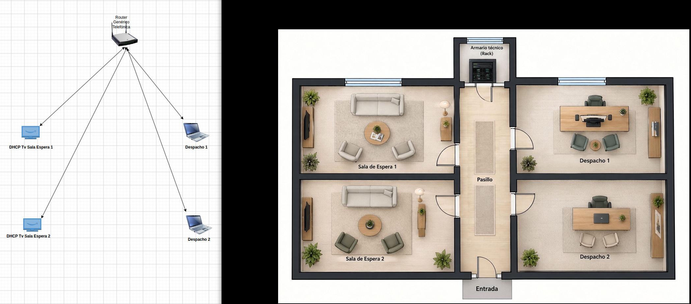
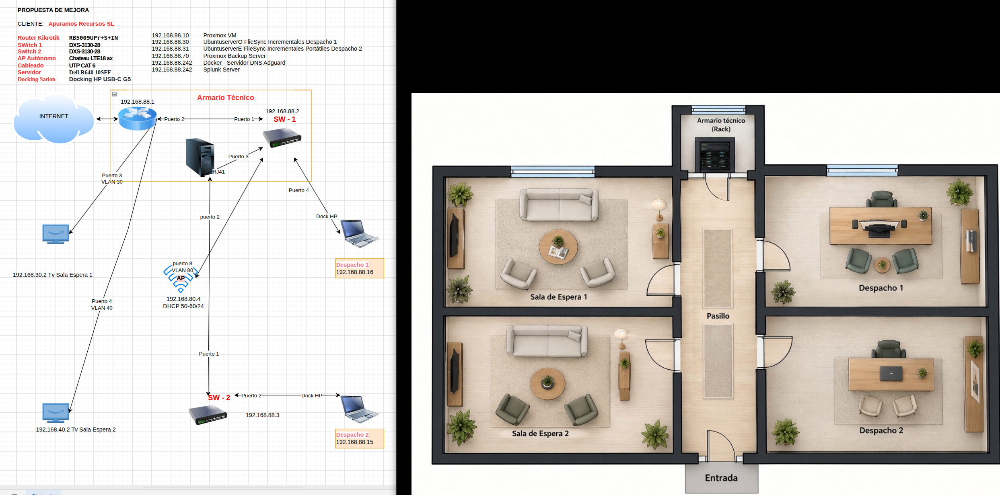

# Proyecto_Ciber_Despacho_Psicologia
(Proyecto para Nuevos Medios.)

Se trata de crear un proyecto de mejora de unas instalaciones preexistentes de un despacho privado de Psicólogos.

Tras una visita compuesta por un Técnico 

**TAREA 3: CURANDO CONTENIDOS**
 
  

Una de las funciones importantes de la práctica docente es la curación de contenido. Tu tutora lo sabe y, para que vayas practicando, te propone la siguiente actividad:

- Familiarízate con alguna herramienta de curación de contenido.
    
- Elige un tema relacionado con algo que te guste: hobby, habilidad, interés, ..
    
- Tendrás que buscar información, seleccionarla, organizarla y prepararla para realizar una breve exposición (no más de 10 minutos)
    
- Presentación de la tarea:
    

1. Herramienta utilizada
    
2. Fuentes seleccionadas
    
3. Guion de la exposición
    

Los siguientes enlaces pueden ayudarte:

[https://www.pearltrees.com/](https://www.pearltrees.com/)

[https://www.symbaloo.com/](https://www.symbaloo.com/)

[https://evernote.com/es-es](https://evernote.com/es-es)

[https://www.educaciontrespuntocero.com/recursos/herramientas-curacion-contenidos/](https://www.educaciontrespuntocero.com/recursos/herramientas-curacion-contenidos/)

[https://www.youtube.com/watch?v=tutT14rkSe8&t=872s](https://www.youtube.com/watch?v=tutT14rkSe8&t=872s) (Tutorial Pearltrees)

---

**Índice de Contenidos**

>1 - Herramientas utilizadas.

- Proxmox Virtual Environment Versión 9.2.20.
- Ubuntu Versión 24.04.5.
- Ubuntu Server Versión 24.04.
- Kali Linux Versión 2026.
- AdGuard.
- DrawIO Versión 32.6.1.
- Wireshark Versión 4.6.6.
- KeepassXC Versión 2.8.0.
- AEGIS 2FA.
- Github Repository (personal).
- Adobe Illustrator 27.0.
- VSCode Versión 1.140.0.

---

>2 - Fuentes seleccionadas.

- <a href="https://www.attack.mitre.org/matrices/enterprise/windows">MITRE ATT&CK</a>
- <a href="https://www.ccn.cni.es">NIS2 Directive</a>
- <a href="https://ens.ccn.cni.es/es">ENS (Esquema Nacional de Seguridad)</a>
- <a href="https://www.incibe.es">Incibe</a>
- <a href="https://www.virustotal.com/gui/home/upload">VirusTotal</a>

---

>3 - Guión de la Exposición.

- Esta breve introducción trata del Certificado de Grado C  Nivel 3 Familia Informática y Telecomunicaciones **[IFCT0109|Seguridad informática]**

---

El primer bloque muestra la visita inicial a el cliente, tras la que se realiza el plano de sus instalaciones así como la topología de red incluyendo los elementos de red actuales.

En este caso se aprecia una instalación típica de una vivienda en la que un equipo genérico y probablemente desactualizado hace la labor de router, servidor DNS, Servidor DHCP y cortaguegos.
Tampoco se observan copias de seguridad totales o incrementales, disponiendo únicamente de sticks USB para realizar las copias cuando se acuerden, no teniendo por tanto copias actualizadas ni cifradas de sus archivos, que siendo de índole médico podrían representar en caso de brecha una sanción que llevaría al cierre de la clínica.

En el caso de usar un SaaS como google drive, se estaría poniendo en juego la seguridad de la información en reposo ya que no habría en un principio más que un usuario/contraseña para acceder.
Aún en los casos de usar 2FA, son muy conocidas y a la vez usadas por actores maliciosos, aplicaciones para sobrepasar esos servicios.

---

La finalización del curso en cuestión permitirá crear las siguientes configuraciones e instalaciones 
de la siguiente imagen, pudiendo crear un proyecto real de una empresa que requiere una mejora en sus instalaciones para cumplir con la Directiva NIS2 y el Esquema Nacional de Seguridad.

---

Como se puede apreciar en la imagen anterior, vemos equipos profesionales dedicados cada uno a una función o varias según el tipo de equipo.

- Virtualización de equipos necesarios mediante Proxmox

- Redundancia de conexiones

- Filtrado DNS seguras y cifradas end to end.

- Dos servidores dedicados a copias de seguridad totales una vez por semana más una diaria incremental, con cifrado de disco completo desde el arranque, XDR y bloqueo ante ataques de fuerza bruta.

- Ambos servidores, independientes entre sí, gestiona un Active Directory que manda las gpo's a cada equipo previniendo accesos indebidos.

- La configuración de los puertos necesarios para sus conexiones con el resto de equipos serán configuradas individualmente y mediante certificados electrónicos que se renovarán una vez al mes.

- Todo elemento de red envía en tiempo real todos los logs importantes que son recogidos, ordenados, filtrados mediante reglas iniciales (más las creadas según las necesidades del cliente) a un servidor Splunk.

- Todo elemento de red será configurado de manera que los puertos no usados actualmente no sean operativos, además de detectar la conexión de equipos nuevos mediante filtrado puerto a puerto.

- Tal y como se aprecia en la imagen, la configuración de red estará basada en la máxima segmentación además de VLAN's, siendo el acceso a esos elementos de red exclusivo de un ordenador en concreto con una dirección en concreto para su administración.

- El AP será de uso exclusivo a clientes en sala de espera y mediante portal cautivo.

---

En cuanto al servidor Splunk, será revisado una vez al día por el servicio de soporte técnico para la detección de anomalías o posibles intentos de acceso indebido, revisión de copias de seguridad y estado de los servidores y elementos de red.

Más abajo se muestra una revisión completa de una incidencia detectada.

---

# Network Forensics
Análisis de tráfico de red usando Wireshark para identificar el acceso inicial, anular la ofuscación de un Javascript malicioso y extraer loe IOC's (ip, hashes de archivos, ejecución de procesos etc.)

---

Obtención de un pcap o parte de un log.

---

Escenario:

Algún empleado nota lentitud en la red o encuentra algún archivo online que no debería ser público etc.

---

Usaremos Kali sobre Proxmox como sistema operativo.

---

Para la obtención de credenciales usaremos KeepasXC.

---

Abrimos pcap con Wireshark

Para la primera cuestión, con Wireshark es sencillo ver al usar el filtro http las conexiones que se establecen;

---

Para la segunda cuestión (Abajo), echamos un vistazo a ver si ha subido algo, o si ya hay algo en el servidor a qué llamar para establecer la conexión ;
http.request.method=="POST"

Que indica que no hay nada, a ver qué pasa con GET.

Echamos un vistazo al GET ;
http.request.method=="GET"

Ahí lo tenemos, un javascript;  "allegato_708.js"

Para la tercera pregunta, voy a coger las conexiones desde Wireshark, File, Export Objects, http y las guardo en el tmp en el que está el pcap.

Teniendo esto ya podemos calcular el SHA256 u otro desde la terminal;

La pregunta pide el sha256 de acceso inicial, con lo que es el del login, que echando un vistazo rápido a VirusTotal, en relaciones vemos los nombres que suele usar, y entre ellos el que hemos encontrado antes ;

En la siguiente pregunta pide el proceso ejecutado, que ya tenemos en captura anterior en behavior de VirusTotal ;

La siguiente pregunta pide la extensión del segundo archivo malicioso. Esto lo tenemos en la captura cuando hemos exportado los objetos http o en la imagen del flow de GET más arriba, "resources.dll".

En la última pregunta, pide el MD5 de resources.dll, que tenemos en detalles de VirusTotal ;

Y con esto ya disponemos de toda la información relevante para enviar a la Dirección de empresa que determinará qué hacer legalmente etc.

